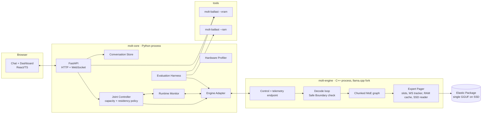

# Design Document — Molt (codename ELASTIC)

## Overview

Molt runs one elastic MoE package on a consumer GPU. It changes two things during a live session:

- **Width (capacity).** Each expert is stored as nested chunks of importance-ordered neurons. Running fewer chunks runs a narrower expert. The scheduler treats the first chunk as mandatory work and later chunks as optional work (Liu et al., 1991).
- **Residency.** Each chunk of each expert is a page. Pages live in VRAM, a capped RAM cache, or the package file on SSD. A working-set policy (Denning, 1968) decides which pages stay in VRAM.

The joint controller links the two. Width sets how many pages each routed expert needs. The VRAM budget sets how many pages fit. When the budget drops mid-session, the controller can keep more distinct experts resident by narrowing them, and each miss then moves fewer bytes. A byte-identical pager such as WiSP cannot use this lever.

This design follows `requirements.md` and `docs/elastic-kiroween-handoff.md`. Every number below that is not from a cited source is marked either as an **estimate** (arithmetic from model config, to be verified) or as an **initial value** (a tunable parameter to be reset after the Baseline Report). No performance threshold is set here.

### Design decisions already approved

| Decision | Choice | Source |
| --- | --- | --- |
| Engine | llama.cpp fork by default, Edge0-infer fork as fallback, behind an Engine Adapter interface | Round 2, decision 8 |
| Model | Qwen3-30B-A3B only, until the Feasibility Round verifies another checkpoint | Round 2, decision 9 |
| Width source | Training-free importance reordering on calibration data (CRISP-style) | Round 2, decision 9 |
| v1 capacity control | Width only, per session, fixed top-K | Round 1, decisions 1–3 |
| Mid-session change | Only at a Safe Boundary, only in response to memory pressure | Round 1, decision 4 |
| Prefetch | Off by default, toggle, measured | Round 2, decision 10 |
| Budgets | VRAM filler and RAM filler processes, plus self-accounting inside Molt | Round 2, decisions 11 and 13 |
| Process layout | C++ per-token code in the Engine fork; Python FastAPI for controller, harness, API; web dashboard over WebSocket | Round 2, decision 13 |

### Test machines (from the builder, 2026-11-11)

| Machine | GPU | CPU | RAM | SSD | Role | Does the SSD tier get exercised? |
| --- | --- | --- | ---: | --- | --- | --- |
| Laptop | RTX 4060 8 GB (CUDA) | Intel i9-14980HX | 16 GB | NVMe | Primary target | Yes, without a cap. The expert bank alone is about 16 GB at Q4 (**estimate**), more than the RAM left after the OS. |
| PC | RX 6650 XT 8 GB (Vulkan) | Intel i3-12100F | 32 GB | NVMe | AMD stretch target | Not by default. The RAM filler applies a RAM Budget to force it (Req 2.6). |

What follows from this:

- **CPU must be recorded per run.** `--n-cpu-moe` runs the offloaded experts on the CPU, so BL-2 depends heavily on the CPU. The two CPUs differ a lot, so BL-2 results from the two machines must not be compared as GPU results. The machine manifest records the CPU model, core and thread counts, and power mode (the laptop may throttle on battery or in quiet mode).
- **Free RAM, not just total RAM.** The profiler and the manifest record total RAM, RAM available after the OS and background apps at session start, and the minimum available RAM during each run. The RAM tier of the pager is sized from available RAM, never from total RAM.
- **Laptop GPU variant.** The laptop's card is presumably the RTX 4060 Laptop GPU, which has different power limits and clocks from the desktop card. The manifest records the exact device name and power limit, and the write-up names the laptop part.
- **Model size.** Molt plans around Qwen3-30B-A3B, not the Edge0 35B. Edge0's README says its 35B needs about 18 GB for the original weights. BL-3 runs that model on both machines. On the laptop it will also exceed the RAM left after the OS.

## Architecture

### Process layout



The engine runs as a separate process for two reasons:

1. **Survivable OOM (Req 7.9).** `molt-core` owns the conversation. If `molt-engine` crashes on out-of-memory, `molt-core` keeps the history, restarts the engine with a narrower configuration, and re-runs prefill on the history. An in-process engine crash would take the history with it.
2. **The same adapter drives baselines.** Stock `llama-server` and `edge0-infer serve` are also separate processes with HTTP APIs. The harness talks to all of them the same way.

### Mechanism and policy split

Per-token work must not wait on Python. The split is:

| Concern | Lives in | Why |
| --- | --- | --- |
| Routing, chunked expert compute, slot lookup, page loads, eviction, working-set tracking | C++ (`molt-engine`) | Runs per layer per token |
| Chosen width `k`, per-layer slot capacity, window `W`, prefetch flag, budgets | Python (`molt-core`), sent as a `PendingConfig` | Changes rarely; needs a model of the whole system |

The controller writes a `PendingConfig` with a sequence number. The engine applies the newest one at its next Safe Boundary and reports the applied sequence number back. The controller never blocks the decode loop.

### Session flow

```mermaid
sequenceDiagram
    participant U as User
    participant C as molt-core
    participant E as molt-engine
    U->>C: launch
    C->>C: profile hardware (Req 3)
    C->>E: start(package, initial config)
    E-->>C: ready + footprint report
    C->>C: startup probe: short decode at k=1..3
    C->>C: choose session profile from Objective (Req 5)
    U->>C: message
    C->>E: generate(history)
    loop each token
        E->>E: Safe Boundary: apply PendingConfig if newer
        E->>E: forward pass (mandatory chunk + optional chunks)
        E-->>C: token + TokenStats
        C->>C: monitor; if memory pressure → post PendingConfig
    end
    C-->>U: streamed tokens + dashboard updates
```

## Components and Interfaces

### 1. Elastic Package and conversion pipeline (Req 4, 1.9)

#### Target model facts (to verify in Task 1)

These come from the Qwen3-30B-A3B `config.json` as recalled. Task 1 must check each one against the published config and record the licence.

| Field | Expected value |
| --- | --- |
| Layers | 48, all MoE |
| Hidden size | 2048 |
| Routed experts per layer | 128 |
| Top-K | 8 |
| Expert intermediate size | 768 |
| Shared experts | none |
| Attention | 32 query heads, 4 KV heads, head dim 128 |

#### Chunked ("shell") expert layout

A plain prefix slice is awkward in GGUF. The down projection's rows run along the intermediate dimension, so a narrower width would need truncated quantized rows, which kernels do not support in general. Molt therefore stores each expert's intermediate dimension as `C` separate chunks:

- `blk.{L}.ffn_gate_exps.c{j}` has shape `[n_embd, S, n_expert]`
- `blk.{L}.ffn_up_exps.c{j}` has shape `[n_embd, S, n_expert]`
- `blk.{L}.ffn_down_exps.c{j}` has shape `[S, n_embd, n_expert]`

Here `S = 768 / C` and `j = 0..C-1`. Chunk 0 holds the most important neurons.

Running width `k` (1 ≤ k ≤ C) computes:

```
y = Σ_{j<k} down_j · ( silu(gate_j · x) ⊙ (up_j · x) )
```

SwiGLU works neuron by neuron, so this equals running the first `k·S` importance-ordered neurons of the original expert. At `k = C` the result equals the original expert up to floating-point summation order and quantization. The router and top-K are unchanged. Router weights apply once, after the chunk sum.

**Initial value: `C = 3`, `S = 256`.** That gives widths of 33%, 67%, and 100%. `S = 256` is a multiple of the k-quant super-block size, so every chunk can use the same quant types as the original model. The handoff's example ladder (75/50/25%) needs `C = 4`, `S = 192`. That only works with 32-element block formats such as Q4_0 or Q8_0. Task 1 decides between the two by quality and kernel support.

| Profile | Chunks `k` | Width | Imprecise Computation role |
| --- | --- | --- | --- |
| Full | 3 | 100% | mandatory + 2 optional |
| Medium | 2 | 67% | mandatory + 1 optional |
| Slim | 1 | 33% | mandatory only |

The handoff's "Emergency" rung is not reachable with `C = 3`. If Task 1 picks `C = 4`, Emergency becomes `k = 1` (25%).

#### Importance and reordering (training-free)

1. Run `llama-imatrix` (an existing llama.cpp tool) on a calibration set using a Q8_0 GGUF of the model. For `ffn_down_exps`, imatrix records per-expert sums of squared input activations, and that input is the intermediate activation `h` for each neuron. Whether the per-expert statistics are exposed in the needed form must be checked in Task 1.
2. For each expert `e` and neuron `i`, compute importance `I[e,i] = sqrt(mean(h_i²)) · ‖W_down[:, i]‖₂`.
3. Permute each expert's gate rows, up rows, and down columns by descending `I`. The permutation is exact, so the full-width output does not change.
4. Split into `C` chunks and quantize each chunk (for example Q4_K_M-equivalent types) with `llama-quantize`, reusing the imatrix.
5. Write one GGUF with the original non-expert tensors plus the chunk tensors and `molt.*` metadata.

The calibration data must not overlap the evaluation set. **Initial value:** the wikitext-2 train split plus a small permissively licensed code corpus. Task 1 records the licences.

#### Package metadata (validated on import, Req 4.3)

| Key | Example | Rule |
| --- | --- | --- |
| `molt.format_version` | `1` | must be known to the engine |
| `molt.base_model` | `Qwen/Qwen3-30B-A3B` | recorded |
| `molt.width.chunks` | `3` | ≥ 3 (Req 4.1) |
| `molt.width.chunk_size` | `256` | `chunks × chunk_size == expert_ff` |
| `molt.importance.method` | `imatrix_l2_down` | recorded |
| `molt.calibration.dataset` | text id + hash | recorded |
| `molt.top_k` | `8` | must equal arch `expert_used_count` |
| every `blk.*.ffn_*_exps.c{j}` | present | all layers × 3 matrices × chunks |

Validation errors name the missing or inconsistent key or tensor.

### 2. molt-engine (llama.cpp fork)

#### Code organisation

New code lives in `engine/molt/` in the Molt repo: the pager, the chunked-MoE graph helper, and the control endpoint. A small patch series in `engine/patches/` hooks it into llama.cpp at a pinned commit (`engine/LLAMA_CPP_COMMIT`). This keeps the patch small, keeps all project code in one repo for judging, and makes upstream rebases manageable. **Open question 1** asks you to confirm this layout.

#### Patch points

| Patch | Purpose |
| --- | --- |
| Model loader | Recognise `molt.*` keys and chunk tensors for the `qwen3moe` arch |
| Graph builder | Replace the fused MoE FFN with the chunk loop above, for `k` from the active config |
| Expert source | In residency mode, the chunk tensors point at slot pools and the routed expert ids are remapped to slot ids |
| Decode loop | Check for a pending config at each Safe Boundary |
| Server | Add `/molt/config` (POST), `/molt/state` (GET), and `/molt/telemetry` (WebSocket) to the `llama-server` fork |

#### Expert Pager (Req 6)

- **Page.** One chunk of one expert in one layer: `(L, e, j)`, holding the gate, up, and down slices. **Estimate:** at about 4.5 bits per weight, a page is about 0.9 MB. The full expert bank is about 18,400 pages, roughly 16 GB.
- **VRAM slot pools.** Each layer has its own pool. A pool is three tensors (gate, up, down) of shape `[n_embd, S, slots_L]` / `[S, n_embd, slots_L]`. Per-layer pools make resizing possible: to shrink, free one layer's pool, allocate a smaller one, and reload that layer's working-set pages from RAM. Temporary extra memory is at most one layer's pool. This follows the fixed slots-per-layer design Edge0 documents.
- **Slot lookup.** After the router's top-K runs for layer `L`, a small host-side op reads the expert ids. It maps each `(L, e, j<k)` to a slot, loads missing pages, and writes a remapped id tensor for `mul_mat_id`. This forces a graph split and a host sync per MoE layer. **This is the main performance risk.** The Task 1 spike measures it (Gate G2).
- **Working-set tracker.** For each layer, a ring buffer holds the last `W` tokens' routed expert sets. `WS_L` is the union of those sets, and a page `(L, e, j)` is in the working set if `e ∈ WS_L` and `j < k`. **Initial value: `W = 32` tokens.** The tracker also records `|WS_L|` for several window sizes so the dashboard can plot Denning's working-set size curve.
- **Eviction.** Pages outside the working set go first, least recently used first. A working-set page is evicted only after the controller has been signalled and has not resolved the shortfall. That case counts as thrashing in telemetry (Req 6.6, 6.7).
- **Thrash signal.** A layer is thrashing when it evicts working-set pages and its miss rate stays above an initial value of 25% over `W` tokens. The pager reports `ws_overflow{L, deficit_pages}` to the controller.
- **RAM cache (warm tier).** Pinned host buffers hold pages up to the RAM Budget, with the same working-set-then-LRU policy over a longer window. **Initial value: `W_ram = 8·W`.**
- **SSD reader (cold tier).** Pages are read from the package file with unbuffered I/O (`FILE_FLAG_NO_BUFFERING` on Windows, aligned reads). The OS page cache therefore does not hide the RAM Budget, and the SSD byte counters are real.
- **Prefetch toggle (Req 6.5).** It is off by default. When on, it uses the next-layer routing guess from the current layer's hidden state, run through layer `L+1`'s router. Prefetches have lower priority than demand loads. The harness measures on against off.
- **Counters (Req 6.8).** Per tier: hits, misses, loads, evictions, and bytes moved (SSD→RAM, RAM→VRAM). Per token: miss stall time.
- **Residency off (Req 6.9).** Every page of the current width sits in VRAM (config A or B), or experts use stock `--n-cpu-moe` static placement (baseline). There are no slot pools.

#### Safe Boundary mechanics (Req 7.3)

A Safe Boundary is any of these points:

1. Between two decode steps, after token `t` is sampled and before the forward pass for `t+1` is built.
2. Between prefill micro-batches.
3. Between prefill and the first decode step.

At a boundary the engine:

1. reads the newest `PendingConfig` (an atomic swap) and returns if its sequence number is not newer than the applied one;
2. applies residency changes: resizes per-layer pools (shrinking first, so peak memory does not rise) and evicts pages that no longer fit;
3. applies the width change by setting `k`. llama.cpp rebuilds the compute graph each step anyway, so the next step simply has a different number of chunk ops;
4. records `config_applied{seq, k, slots, stall_ms}` in telemetry.

**KV cache across a width change.** The KV entries for earlier tokens were computed at the old width. They are kept and not recomputed. Attention shapes do not depend on `k`, so nothing breaks, but the context then holds states from mixed widths. This is part of the imprecise result and is reported, not hidden.

**What is excluded.** The controller API has no access to token ids, token text, or logits. It receives only memory, residency, and timing telemetry. Choosing width by token content is therefore impossible by construction, not just by policy (Req 5.4).

**Failure inside a token (Req 7.9).** If an allocation or load fails during a forward pass, the engine aborts that step. It removes the partial position from the KV cache (`llama_memory_seq_rm` or its equivalent at the pinned commit), reports `oom{phase}`, and waits for a new config. If the engine process dies instead, `molt-core` restarts it at the next narrower configuration and re-runs prefill on the stored history. If even the narrowest configuration fails, the user sees the cause and the history stays visible.

### 3. Engine Adapter (Python)

```python
class EngineAdapter(Protocol):
    capabilities: EngineCaps          # width_control, residency_control, telemetry
    def start(self, package: Path, cfg: EngineConfig) -> EngineInfo: ...
    def generate(self, messages: list[Msg], sampling: Sampling) -> Iterator[TokenEvent]: ...
    def post_config(self, cfg: PendingConfig) -> int: ...          # returns seq
    def telemetry(self) -> Iterator[TelemetryEvent]: ...
    def perplexity(self, text_chunks: list[str], ctx: int) -> float: ...
    def health(self) -> Health: ...
    def stop(self) -> None: ...
```

| Implementation | Purpose | `width_control` | `residency_control` |
| --- | --- | --- | --- |
| `MoltLlamaCppAdapter` | Molt runtime, configs A–D | yes | yes |
| `StockLlamaCppAdapter` | Baselines: full offload, `--n-cpu-moe` | no | no |
| `Edge0Adapter` | Edge0-infer reference baseline; fallback runtime if Route B is chosen | no (unless forked) | its own slots |
| `SimEngineAdapter` | Simulated engine for developing and testing the controller without a GPU | yes | yes |

`SimEngineAdapter` replays a recorded routing trace and models page sizes, slot capacity, PCIe and SSD bandwidth, and per-chunk compute time. It lets the controller and dashboard be built and tested in this sandbox, where there is no GPU.

### 4. Hardware Profiler (Req 3)

| Value | Source | Fallback if missing |
| --- | --- | --- |
| GPU vendor, model, total and free VRAM | `molt-engine --probe` (ggml backend device memory query), NVML on NVIDIA | **Initial value:** budget = 50% of total VRAM, shown as "assumed" |
| VRAM in use by other processes | NVML / DXGI `QueryVideoMemoryInfo` | treat as unknown; rely on self-accounting |
| Total RAM, and RAM available after OS overhead (sampled at start and during the session) | `psutil.virtual_memory().available` | **Initial value:** RAM Budget = 50% of available RAM |
| CPU model, cores and threads, power mode | `platform`, `psutil`, Windows power scheme query | recorded as unknown |
| Free SSD space at package path | `shutil.disk_usage` | refuse import if smaller than the package |
| Backends | `molt-engine --probe` | CPU only |
| Sysmem fallback policy (NVIDIA, Windows) | recorded manually in the Baseline Report | see Risks |

While a session runs, free VRAM is sampled at every Safe Boundary and at least every **250 ms (initial value)** (Req 3.5).

### 5. Joint Controller (Req 5, 7)

#### Memory model

For the current configuration:

```
need(k, slots) = fixed + kv(ctx) + compute_buf + Σ_L slots_L · page_bytes + margin
```

- `fixed` covers non-expert weights. **Estimate:** about 1.5 B parameters, under 1 GB at Q4.
- `kv(ctx)` **estimate:** about 96 KiB per token at f16, so about 0.75 GB at 8K context.
- `compute_buf` is measured after start.
- `margin` **initial value:** 5% of the budget.

The engine reports actual allocations, and the controller uses those instead of the formula whenever they exist.

`effective_budget = min(user VRAM budget, measured_free + own_usage)`, so external GPU use lowers the budget automatically.

#### Session start (Req 5.3, 5.6, 5.7)

1. Compute the page capacity `P_cap` that fits in `effective_budget`.
2. The startup probe runs a short fixed decode at each `k` and records per-token latency `t(k)` and miss rate. Those are the inputs for the Objective rule.
3. Pick `k`, subject to the Objective:

| Objective | Ceiling `k_max` | Rule at session start |
| --- | --- | --- |
| Quality | C | largest `k` whose working set fits |
| Balanced | C | largest `k` whose working set fits and whose `t(k)` ≤ `D_bal` |
| Speed | C − 1 | smallest `t(k)` among `k` whose working set fits |

`D_bal` is set from the Baseline Report, not here. Until it exists, Balanced behaves like Quality and the UI says so.

4. If no `k ≥ 1` fits, refuse to start and explain why (Req 5.7).

Speed caps optional work at `C − 1` chunks. Quality allows all of it. Balanced sits between them through the deadline. This is the "how much optional work is allowed" mapping from Liu et al.

#### Mid-session adaptation (memory pressure only)

The pressure signals are:

1. `effective_budget < need(current)`, caused by an external app, the VRAM filler, or the user lowering the budget in the UI;
2. `ws_overflow` from the pager, meaning the working set no longer fits (thrashing).

The controller responds in this order (Req 7.4, 7.5):

1. Shrink slots holding pages outside the working set, per layer.
2. If the shortfall remains, or the working set still does not fit, narrow `k` by one. Each routed expert then needs one fewer page, so the same slots hold more distinct experts and each miss costs one chunk less.
3. Repeat at later boundaries until it fits, down to `k = 1`. Then, if needed, trim per-layer slots to the minimum that holds one token's routed set (`top_k × k` pages per layer).
4. If even that does not fit, stop generation cleanly at the boundary and report the failure (Req 7.9).

Widening (Req 7.6, 7.7) happens when `effective_budget ≥ need(k+1, WS-sized slots) · (1 + h)` holds continuously for `T_hold`, and only up to the Objective ceiling. **Initial values: `h = 10%`, `T_hold = 5 s`.** Narrowing happens immediately and widening is delayed, which gives the hysteresis.

Latency on its own never changes width mid-session. Thrashing shows up as both latency and `ws_overflow`, and only the `ws_overflow` signal acts. This keeps Req 5.4 strict.

#### Decision log (Req 7.10)

Every decision is logged as JSON lines with its inputs, the rule that fired, and the output. Example: `{t, seq, inputs:{budget, free, ws_sizes, miss_rate}, rule:"narrow_ws_overflow", from:{k:3,slots:…}, to:{k:2,slots:…}}`. The dashboard shows these lines in plain words (Req 9.5).

### 6. Runtime Monitor (Req 7.1)

The monitor consumes engine telemetry: per-token latency, TTFT, tok/s, VRAM and RAM use, pager counters, `config_applied`, and `oom`. It aggregates them into 250 ms frames (**initial value**) for the controller and the dashboard, and writes raw events to a per-session file for the harness.

### 7. VRAM and RAM fillers (`molt-ballast`)

`molt-ballast` is a small C++ tool with a local control port.

- `--vram`: allocates GPU memory in 256 MB blocks (CUDA first, Vulkan later), touches it so it is committed, and resizes on command. The UI and the harness use it for the Live Squeeze (8 → 6 → 4 GB) and for budget simulation in baselines.
- `--ram`: commits and touches system RAM (`VirtualAlloc` + `VirtualLock` after raising the working-set limit). This is needed on the 32 GB PC so that the SSD tier is exercised for both Molt and the baselines (Req 2.6). The 16 GB laptop needs no RAM filler. **Initial value:** on the PC, the filler leaves the same available RAM the laptop has at session start, so the two machines face matching RAM pressure.

Budgets are enforced in two ways:

1. **Self-accounting** inside Molt is the primary, deterministic limit on Molt.
2. **Filler processes** create real external pressure and give baselines the same constraint.

The harness checks peak per-process usage against the budget for every run (Req 7.8, 11.2).

### 8. API and UI (Req 8, 9)

#### FastAPI endpoints

- `POST /api/chat`: streams tokens over server-sent events.
- `GET/POST /api/session`: Objective, VRAM Budget, RAM Budget, prefetch toggle, thinking toggle (default off).
- `POST /api/squeeze`: sets the VRAM filler size, for the demo.
- `GET /api/profile`: hardware profile.
- `WS /ws/telemetry`: 250 ms frames plus decision events.

#### Web app (React + Vite + TypeScript, served by FastAPI)

- **Chat panel.** Objective selector, budget slider, and a thinking toggle (default off). No config files (Req 8.4, 8.5).
- **VRAM gauge.** Usage bar with a budget marker and the external usage shown separately.
- **Expert heatmap.** A canvas of 48 layers × 128 experts. Fill shows the tier and chunks resident (0–3 chunks in VRAM, RAM, or SSD). An outline marks working-set membership.
- **Skin indicator.** Current profile (Full, Medium, Slim) and Objective.
- **Speed tiles.** tok/s and TTFT for the current request.
- **Decision feed.** For example: "budget 6 GB → Medium (k=2), evicted 412 cold pages."
- **Working-set curve.** `|WS|` against window size.

The conversation lives in `molt-core`. A config change or engine restart does not require resending the message (Req 8.6).

Offline (Req 8.3): the app loads no external assets, all fonts and scripts are bundled, and the server binds to `127.0.0.1` only.

### 9. Evaluation Harness (Req 2, 10, 11)

#### Fixed evaluation set (Req 10.7)

| Part | Content | Scoring | Licence (to verify in Task 1) |
| --- | --- | --- | --- |
| Perplexity | wikitext-2 **test** split, first N windows of 512 tokens (**initial value** N = 64) | mean perplexity | CC BY-SA |
| Coding | 20 fixed HumanEval problems (ids listed in `harness/evalset/coding.json`) | pass@1, greedy, run offline in a sandboxed subprocess with a timeout | MIT |
| Reasoning | 20 fixed GSM8K test problems (ids listed in `harness/evalset/reasoning.json`) | exact match on the final number | MIT |

- **Sampling (identical for every configuration):** greedy decoding, fixed `max_tokens`, fixed seed, the Qwen3 chat template with thinking disabled (`/no_think`) so runs stay short. Every setting is stored with each result.
- **Problem selection:** fixed by a seeded draw once, then frozen in the repo.
- **Quality score:** the three parts are reported separately, not combined. Any combined "usefulness threshold" for Req 11.3 is set from the Baseline Report.

#### Configurations

| Id | Runtime | Width | Residency |
| --- | --- | --- | --- |
| A Full | molt-engine | fixed `k = C` | off (all pages in VRAM; runs only where it fits, otherwise recorded as OOM) |
| B Slim | molt-engine | adaptive (controller, residency off) | off |
| C Offloaded | molt-engine | fixed `k = C` | on (working-set pager) |
| D Elastic | molt-engine | adaptive | on |
| BL-1 | stock llama.cpp | — | full GPU offload where it fits |
| BL-2 | stock llama.cpp | — | `--n-cpu-moe N`, with `N` set to the smallest value that fits the budget |
| BL-3 | edge0-infer | — | Edge0 slots (reference point, different checkpoint) |

The matrix covers VRAM budgets of 4, 6, and 8 GB, contexts of 2K, 4K, and 8K, and RAM Budget off or on (on only where RAM holds the whole package).

Per run the harness records TTFT, generation tok/s, prompt-processing tok/s, peak VRAM, peak RAM, minimum available system RAM, SSD bytes (Molt counters plus OS process I/O counters for baselines), quality, OOM count, and the machine manifest (Req 2.7). The manifest holds the GPU name and power limit, the CPU model and thread count, the power mode, total and available RAM, the SSD model and interface, the OS and driver versions, and the Engine version.

The RAM Budget dimension applies only on the PC. On the laptop, runs use available RAM as it is. BL-2 results are labelled with the CPU they ran on.

**Computation (Req 11.3).** Active expert parameters per token are `layers × top_k × 3 × n_embd × k·S`. FLOPs per token are about twice the active parameters. Both are reported analytically per `k` and checked against measured per-layer expert time.

#### Squeeze scenario

A scripted budget schedule runs during a fixed conversation: 8 → 6 → 4 GB, then back to 8 GB. The harness records whether the conversation survives, the stall at each change, tok/s, and quality in each phase.

#### Report

The harness writes CSV, JSON, and Markdown plots of the performance envelope (quality against tok/s against peak VRAM). Rows where D does not beat B or C are shown in the same table as rows where it does (Req 10.6, 11.5). With 20 + 20 problems, the coding and reasoning scores have high variance. The report shows the number of problems solved (for example 14/20), not just a percentage, and treats a difference of one or two problems as noise.

## Data Models

```python
class Objective(str, Enum): SPEED = "speed"; BALANCED = "balanced"; QUALITY = "quality"

class EngineConfig(BaseModel):
    width_k: int                    # 1..C
    residency: bool
    slots_per_layer: list[int]      # len == n_layers
    ws_window: int                  # W tokens
    prefetch: bool = False
    ram_budget_bytes: int | None

class PendingConfig(EngineConfig):
    seq: int
    reason: str                     # rule name, for the decision log

class TokenStats(BaseModel):
    seq_applied: int; t_token_ms: float; miss_stall_ms: float
    vram_used: int; ram_used: int
    hits: dict[Tier, int]; misses: dict[Tier, int]
    bytes_in: dict[Tier, int]; evictions: int
    ws_size_per_layer: list[int]

class Decision(BaseModel):
    t: float; seq: int; rule: str
    inputs: dict; before: EngineConfig; after: EngineConfig
```

There are no token ids, text, or logits in any type the controller receives (Req 5.4).

## Correctness Properties

These are invariants for property-based tests (`hypothesis`) over `SimEngineAdapter` traces, and for engine unit tests where noted.

1. **Budget.** At every Safe Boundary, the accounted VRAM is at or below the effective budget (Req 7.8).
2. **Working set kept.** While `|WS| · k ≤ slots`, no page in the working set is evicted (Req 6.3).
3. **Eviction order.** Every eviction of a working-set page is preceded by evictions of all non-working-set pages in that layer and by a `ws_overflow` signal (Req 6.6, 6.7).
4. **Width only at boundaries.** `k` changes only inside a boundary-apply step, never inside a forward pass (Req 5.4, 7.3).
5. **Content-blind.** The controller's output is a function of telemetry only. Permuting token ids in a trace while keeping the routing changes no decision (Req 5.4).
6. **Ceiling.** `1 ≤ k ≤ k_max(Objective)` always holds (Req 5.3).
7. **Top-K fixed.** The number of routed experts per token per layer equals `molt.top_k` in every configuration (Req 5.5).
8. **Hysteresis.** No sequence of decisions changes `k` from `a` to `b` and back to `a` within `T_hold` (Req 7.7).
9. **Bytes per miss.** A miss at width `k` loads at most `k` pages for that expert (Req 6.4).
10. **Full-width equivalence (engine test).** At `k = C`, the chunked expert output matches the original fused expert within quantization tolerance on fixed inputs. At any `k`, the chunk loop output equals a reference prefix-width FFN computed in f32.
11. **History survives.** After any injected OOM or engine crash, the conversation store is unchanged (Req 7.9).

## Error Handling

| Failure | Detection | Response |
| --- | --- | --- |
| Package metadata invalid | validator on import | reject; error names key or tensor (Req 4.3) |
| Narrowest config does not fit at start | start-up memory model | refuse to start; show budget, need, and what to free (Req 5.7) |
| External VRAM grab | free-VRAM sample, `effective_budget` drop | narrowing sequence in the Joint Controller |
| Working set overflow | pager `ws_overflow` | narrow `k` |
| OOM in a step | engine `oom` event | abort step, roll back the partial KV position, wait for a narrower config, retry |
| Engine crash | adapter health check, process exit | restart at a narrower config, re-run prefill on history; if the narrowest fails, report and keep history |
| SSD read error | I/O status | retry once, then fail the request with the page id; session stays open |
| Telemetry gap | missing frames for more than 1 s | dashboard shows "stale"; controller holds its last config |
| Filler cannot allocate | ballast returns an error | report the actual filler size; harness marks the run invalid |

## Testing Strategy

- **Python unit and property tests (`pytest`, `hypothesis`).** Package validator, memory model, Objective rules, controller state machine, working-set tracker reference implementation, decision log, and correctness properties 1–9 and 11 on `SimEngineAdapter`. These run in this sandbox and in CI without a GPU.
- **Engine tests (CTest).** The chunked FFN equivalence test (property 10), the slot-lookup remap test, and the pager eviction-order test on the CPU backend. These run in CI. CUDA runs happen on the RTX 4060 machine.
- **Conversion checks.** The permutation is exact (full-width perplexity unchanged within noise), and chunk shapes and metadata are consistent.
- **Harness smoke test.** One prompt per part on `SimEngineAdapter` checks the pipeline end to end.
- **Hardware runs.** Baselines, the 2x2 matrix, and the squeeze scenario on the RTX 4060. Results are committed under `docs/results/` with machine manifests.
- **Web.** Component tests (`vitest`) for gauge, heatmap, and decision-feed rendering from recorded telemetry.

Tests are only written where tasks call for them. This section defines what each task's verification means.

## Feasibility Gates (decided in Task 1)

| Gate | Question | Pass | If it fails |
| --- | --- | --- | --- |
| G0 Novelty | Does CRISP (full paper) or other found work already adapt width and residency online to a changing budget with a user objective? | No | Narrow the claim again before any write-up (Req 1.8) |
| G1 Model | Is Qwen3-30B-A3B available, with an acceptable licence and config matching the table above? | Yes | Pick another verified small MoE; MoSE only if checkpoints exist |
| G2 Engine | On the llama.cpp fork at a pinned commit, do (a) chunked `mul_mat_id` and (b) a per-MoE-layer host split for slot remapping run on CUDA, with overhead you accept after seeing the numbers? | Yes | Try Route B (Edge0-infer fork); if both fail, report the smallest engine change and stop for a decision (Req 1.7) |
| G3 Width quality | Do importance-ordered `k = 2` and `k = 1` keep useful quality on the eval set? (You judge from the numbers; no threshold is preset.) | Yes | Try `C = 4`; consider recovery fine-tuning as a stretch; or MoSE if checkpoints exist |
| G4 Budget enforcement | Do the fillers create real pressure on Windows (WDDM may move other processes' VRAM to system memory), and does NVIDIA's sysmem fallback setting turn OOM into silent slowdown? | Understood and recorded | Rely on self-accounting; set "Prefer No Sysmem Fallback" for runs; document it |

Task 1 also verifies these existing-feature questions:

- Does current llama.cpp already copy only the used experts when host-resident MoE weights are offloaded to the GPU? If so, that changes BL-2 and may give the miss path for free.
- Does `llama-imatrix` expose per-expert statistics for `ffn_down_exps`?
- Is Edge0's Windows backend Vulkan-only, and does `edge0-infer` run on the RTX 4060?

## Risks

| Risk | Effect | Mitigation |
| --- | --- | --- |
| Per-layer host sync is too slow | Residency mode loses to `--n-cpu-moe` | Measured in G2; batch remaps; fall back to Route B |
| Width quality at 33% is poor | Slim profile is "fast gibberish" | G3; `C = 4`; frame Slim as an emergency only |
| WDDM VRAM virtualisation | Filler does not produce OOM in baselines | G4; self-accounting; driver setting documented |
| PCIe 4.0 x8 on RTX 4060 | Misses are expensive | This is the core argument for narrowing; measure bytes per token per `k` |
| Edge0 outperforms Molt on speed | Weaker pitch | Pitch is the live budget squeeze and quality as a variable, not peak tok/s; report honestly |
| Scope creep into AMD | Delays NVIDIA path | AMD only after the NVIDIA 2x2 is done (Req 13.1) |

### Back-of-envelope (estimates, not benchmarks)

These come from config arithmetic only and are here to show why width matters. Verify before quoting.

- Pages touched per token at full width: 48 layers × 8 experts × 3 chunks = 1,152 pages, about 1 GB if none were resident. At `k = 1` that is 384 pages, about 0.35 GB.
- Total expert bank: about 18,400 pages, about 16 GB at Q4. A 4 GB budget leaves room for roughly a tenth of the pages once non-expert weights and KV are counted.

## Requirements Traceability

| Requirement | Design section |
| --- | --- |
| 1 Feasibility | Feasibility Gates |
| 2 Baselines | 9 Harness (BL-1..3), 7 Fillers |
| 3 Profiling | 4 Hardware Profiler |
| 4 Package | 1 Elastic Package |
| 5 Capacity | 5 Joint Controller (session start), Safe Boundary |
| 6 Residency | 2 Expert Pager |
| 7 Joint Controller | 5 Joint Controller, 6 Monitor, Safe Boundary, Error Handling |
| 8 Chat | 8 API and UI |
| 9 Dashboard | 8 API and UI |
| 10 Harness | 9 Harness |
| 11 Success criteria | 9 Harness (computation, report) |
| 12 Write-up | Overview, Gate G0 (README content is a task) |
| 13 AMD | Adapter and filler Vulkan paths, after NVIDIA |
| 14 V4.1 Flash | Not designed in v1; revisit after Req 11.1–11.4 pass |
| 15 Compliance | Repository layout (structure.md), tasks |

## Resolved Design Decisions (approved 2026-11-11)

1. **Engine code layout:** in-repo. New C++ goes in `engine/molt/`, with a patch series in `engine/patches/` against the llama.cpp commit pinned in `engine/LLAMA_CPP_COMMIT`. There is no submodule, so judges see all the code in one public repo with `.kiro` at the root.
2. **Chunk count:** `C = 3` is primary. `C = 4` is a G3 fallback only and is not tested side by side in Task 1. If `k = 1` (33%) keeps useful quality, the 25% Emergency rung is not needed.
3. **Speed objective:** capped at `C − 1` chunks even when VRAM is plentiful. Narrower experts cost fewer FLOPs per token, so the cap is a real latency trade-off.
4. **Thinking mode:** off by default in the demo chat, with a user toggle in the UI. The eval always runs with thinking off.
5. **Small eval set:** 20 + 20 problems give high variance. The three scores are always reported separately, and the write-up must not claim a small quality difference as meaningful.
