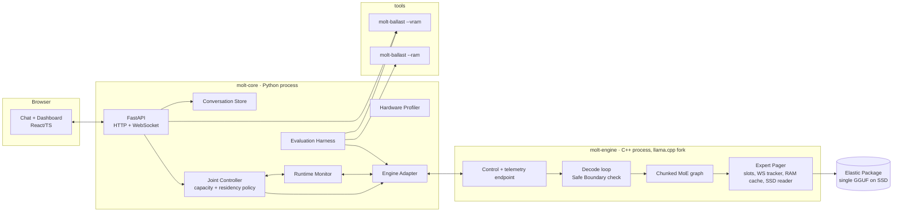

# Molt

**One model, any GPU — it molts to fit.**

Molt is a local inference runtime for Mixture-of-Experts language models on consumer GPUs. When the model does not fit in VRAM, or when another app takes memory away mid-conversation, Molt sheds expert width and reshuffles which experts stay on the GPU so the conversation keeps going. Molt ships one model package, adapts to whatever GPU it runs on, and degrades gracefully instead of failing at a hard VRAM limit.

---

## Contents

- [What is Molt](#what-is-molt)
- [Why it exists](#why-it-exists)
- [How it works](#how-it-works)
- [Test machines](#test-machines)
- [Quickstart](#quickstart)
- [Demo](#demo)
- [Benchmarks](#benchmarks)
- [Prior art](#prior-art)
- [The Resurrection story](#the-resurrection-story)
- [Status](#status)
- [License](#license)

## What is Molt

Molt runs one elastic MoE model package. Its first target is [Qwen3-30B-A3B](https://huggingface.co/Qwen/Qwen3-30B-A3B), pending the Model Feasibility Round. Molt controls two things at the same time:

- **Width ("skin shedding").** Each expert is stored as three nested chunks of neurons, ordered by importance. Running one, two, or three chunks runs the expert at 33%, 67%, or 100% width. Narrower experts cost fewer FLOPs per token and fewer bytes to load.
- **Residency.** Each chunk of each expert is a page that lives in GPU memory, system RAM, or the package file on SSD. A working-set policy keeps the experts the conversation has used recently on the GPU.

A joint controller links the two. When the VRAM budget drops, it first evicts experts the conversation is no longer using. If that is not enough, it narrows the experts so more of them fit. When memory frees up, it widens them again.

Using Molt takes four steps:

1. Import a Molt package.
2. Launch Molt and let it profile the hardware.
3. Choose an objective: **Speed**, **Balanced**, or **Quality**.
4. Chat, and watch the dashboard as the runtime adapts.

There are no configuration files to edit.

## Why it exists

Running a capable model locally on an 8 GB gaming GPU means picking a bad option:

- **A small model** fits, but loses capability.
- **A large model with static offload** fits, but moves weights over PCIe or from disk so often that it can crawl.
- **Hand tuning** quantization, offload layers, and context length is fiddly, and the result breaks as soon as another application takes GPU memory.

Molt is for people running local models on Windows PCs with roughly 6–12 GB of VRAM: developers who want private, offline coding help, local AI enthusiasts, and students who cannot justify a high-end GPU. Molt does not promise the same quality or speed on every machine. It aims for the best capability-for-performance trade-off each machine can sustain, and it keeps the conversation alive when conditions change.

## How it works

### The pieces

| Component | What it does |
| --- | --- |
| **Elastic Package** | A single GGUF file. Each expert's neurons are reordered offline by importance, using calibration data and no training, then split into three chunks. At full width the output matches the original model up to quantization. |
| **molt-engine** | A fork of [llama.cpp](https://github.com/ggml-org/llama.cpp). It runs each expert as a loop over its active chunks and pages chunks between VRAM, a capped RAM cache, and the SSD. It tracks each layer's working set and applies new settings only between tokens. |
| **molt-core** | A Python service with the joint controller, hardware profiler, runtime monitor, and conversation store. It sends settings to the engine without ever blocking token generation. |
| **Dashboard** | A live VRAM gauge with the budget marked, a 48 × 128 heatmap showing where each expert lives, the current width, tok/s and time to first token, and a plain-language feed of every controller decision. |
| **molt-ballast** | Fills a set amount of VRAM or RAM on demand. It simulates smaller GPUs, creates the mid-conversation "squeeze", and gives the baselines the same limits as Molt. |

### Rules the runtime keeps

- **Top-K is fixed.** Molt always uses the same number of experts per token. Width is the only capacity control, so each mechanism's effect can be measured cleanly.
- **Changes happen only between tokens, and only under memory pressure.** The controller never sees token text or logits, so it cannot pick widths based on content.
- **Mandatory work always runs.** Attention, routing, and each selected expert's first chunk run on every token. The wider chunks are optional work that the objective and the memory budget allow or withhold.
- **The conversation survives the engine.** The engine runs as a separate process. If it runs out of memory, Molt keeps the history, restarts the engine at a narrower setting, and continues.

## Test machines

| Machine | GPU | CPU | RAM | Storage | Role |
| --- | --- | --- | ---: | --- | --- |
| Laptop | NVIDIA GeForce RTX 4060 8 GB (CUDA) | Intel Core i9-14980HX | 16 GB | NVMe SSD | Primary target |
| Desktop | AMD Radeon RX 6650 XT 8 GB (Vulkan) | Intel Core i3-12100F | 32 GB | NVMe SSD | Cross-vendor compatibility |

Both GPUs have 8 GB, so they test portability across vendors, not low-end versus high-end hardware. Smaller tiers are simulated by holding the GPU to 4 GB and 6 GB budgets. That simulates memory limits only, not the slower compute of a weaker GPU, and every tier comparison in this project says so. On the 32 GB desktop, a RAM cap makes sure the SSD tier is exercised the same way it is on the 16 GB laptop.

## Quickstart

> **Planned flow.** Commands are coming after Task 2.

Molt targets Windows 10 and 11. Builds and the first Molt package will be published on the [Releases](https://github.com/SebastianAbeSantoso/Molt/releases) page.

**System requirements**

| | Requirement |
| --- | --- |
| OS | Windows 10 or 11, 64-bit |
| GPU | NVIDIA with CUDA and at least 8 GB VRAM (primary); AMD via Vulkan (compatibility target) |
| Storage | NVMe SSD recommended; the SSD is the cold tier for expert weights |
| Network | Needed only to download Molt and the model package. Chat runs fully offline. |

**Using Molt (planned)**

1. Download Molt and an Elastic Package from the Releases page.
2. Start Molt. It profiles the GPU, system RAM, and storage, and shows what it found.
3. Open the local web interface. It binds to `127.0.0.1` only, and prompts never leave the machine.
4. Choose **Speed**, **Balanced**, or **Quality**, and start chatting.
5. Optionally lower the VRAM budget during a conversation and watch Molt adapt.

Reasoning ("thinking") mode is off by default to keep replies fast. You can turn it on in the chat panel.

## Demo

A demo video under three minutes walks through two moments:

1. **The Impossible Model.** A standard setup tries a 30B-class MoE on an 8 GB laptop GPU. Then Molt runs the same model and prompt on the same machine.
2. **The Live Squeeze.** In the middle of a conversation, the VRAM budget drops from 8 GB to 6 GB to 4 GB. Molt narrows and evicts experts, and the conversation keeps going.

The video ends with a quick quality check, to show the output is still useful and not fast gibberish.

**Video:** TBD

## Benchmarks

Molt is evaluated with a controlled 2x2 experiment on one model package and one workload. Each mechanism is switched on and off on its own:

| Configuration | Adaptive width | Dynamic residency |
| --- | :---: | :---: |
| **A — Full** | – | – |
| **B — Slim** | ✓ | – |
| **C — Offloaded** | – | ✓ |
| **D — Elastic** | ✓ | ✓ |

### Results

All results come from the evaluation run (Task 12) on the RTX 4060 laptop.

| Config | VRAM budget | TTFT | Gen tok/s | Prompt tok/s | Peak VRAM | Peak RAM | SSD read | Perplexity | Coding (n/20) | Reasoning (n/20) | OOM |
| --- | ---: | ---: | ---: | ---: | ---: | ---: | ---: | ---: | ---: | ---: | ---: |
| A — Full | 4 GB | TBD | TBD | TBD | TBD | TBD | TBD | TBD | TBD | TBD | TBD |
| A — Full | 6 GB | TBD | TBD | TBD | TBD | TBD | TBD | TBD | TBD | TBD | TBD |
| A — Full | 8 GB | TBD | TBD | TBD | TBD | TBD | TBD | TBD | TBD | TBD | TBD |
| B — Slim | 4 GB | TBD | TBD | TBD | TBD | TBD | TBD | TBD | TBD | TBD | TBD |
| B — Slim | 6 GB | TBD | TBD | TBD | TBD | TBD | TBD | TBD | TBD | TBD | TBD |
| B — Slim | 8 GB | TBD | TBD | TBD | TBD | TBD | TBD | TBD | TBD | TBD | TBD |
| C — Offloaded | 4 GB | TBD | TBD | TBD | TBD | TBD | TBD | TBD | TBD | TBD | TBD |
| C — Offloaded | 6 GB | TBD | TBD | TBD | TBD | TBD | TBD | TBD | TBD | TBD | TBD |
| C — Offloaded | 8 GB | TBD | TBD | TBD | TBD | TBD | TBD | TBD | TBD | TBD | TBD |
| D — Elastic | 4 GB | TBD | TBD | TBD | TBD | TBD | TBD | TBD | TBD | TBD | TBD |
| D — Elastic | 6 GB | TBD | TBD | TBD | TBD | TBD | TBD | TBD | TBD | TBD | TBD |
| D — Elastic | 8 GB | TBD | TBD | TBD | TBD | TBD | TBD | TBD | TBD | TBD | TBD |

### Baselines

The same workload also runs on standard setups. Edge0 runs its own checkpoint, so it is a reference point and not a same-model comparison.

| Baseline | Setup | VRAM budgets | Results |
| --- | --- | --- | --- |
| BL-1 | llama.cpp, full GPU offload where it fits | 4 / 6 / 8 GB | TBD |
| BL-2 | llama.cpp, `--n-cpu-moe` static expert offload | 4 / 6 / 8 GB | TBD |
| BL-3 | [Edge0](https://github.com/Edge0-AI/edge0) `edge0-infer` | 4 / 6 / 8 GB | TBD |

### How results are measured

- **Eval set.** Perplexity on wikitext-2 test, 20 fixed HumanEval problems, and 20 fixed GSM8K problems. Decoding is greedy with the same prompts and settings for every configuration, and thinking mode is off. The three scores are reported separately. With 20 problems per set, a difference of one or two solved problems is treated as noise.
- **Contexts.** Each configuration also runs at 2K, 4K, and 8K tokens of context. Results are published as a quality-versus-latency-versus-memory envelope, not just a ranking.
- **Honest outcomes.** Rows where the Elastic configuration does not beat Slim or Offloaded are published alongside the rows where it does. Molt claims the joint advantage only where the data shows it.
- **CPU dependence.** `--n-cpu-moe` results depend heavily on the CPU, so they are labelled with the machine they ran on.

## Prior art

Each half of Molt builds on serious existing work.

| Work | What it does | How Molt relates |
| --- | --- | --- |
| [WiSP](https://arxiv.org/abs/2606.21868) (Nokia, 2026) | Treats low-resource MoE serving as a working-set problem on the GPU. A routing-aware expert pager with byte-identical outputs, plus MV-WSA, a live controller that splits VRAM between resident experts and the KV cache. | Molt's residency policy uses the same working-set view. WiSP keeps computation exact on purpose. Molt also changes how much of each expert runs. |
| [CRISP](https://arxiv.org/abs/2610.37442) (2026) | Reorders expert neurons by importance so one stored expert supports multiple widths, and co-designs that pruning with runtime scheduling of expert loading on edge servers. | Molt's width chunks use the same importance-reordering idea. Molt does not claim importance-ordered widths or joint width-and-loading optimisation in general. |
| [Edge0](https://github.com/Edge0-AI/edge0) ([paper](https://arxiv.org/abs/2609.18063), 2026) | Streams MoE experts from SSD into fixed slots per layer, with a trained routing predictor, on consumer devices. | A direct neighbour on the residency side, and one of Molt's baselines. |
| [MoSE](https://arxiv.org/abs/2602.06154) (ICML 2026) | An MoE architecture with nested, slimmable experts trained to run at variable widths. | A fallback source of width-capable checkpoints. Molt's main route converts a pretrained model without training. |
| [HydraLLM](https://arxiv.org/abs/2610.23455) (2026) | An elastic architecture where the number of active attention heads sets nested widths across the whole network. | Shows nested widths in dense models. Molt applies width inside MoE experts. |
| [DyMoE](https://arxiv.org/abs/2603.19172) (2026) | Dynamic expert orchestration with runtime mixed-precision quantization and look-ahead prefetching for edge MoE inference. | Related precision-side work. Precision skins are outside Molt's first release. |
| [D2MoE](https://arxiv.org/abs/2504.15299) (2025) | Matryoshka weight quantization, so experts nest across bit-widths, with I/O-aware scheduling on devices. | The model for a possible future precision skin. |
| [MC-MoE](https://arxiv.org/abs/2410.06270) (2024) | Training-free mixed-precision quantization plus online dynamic pruning for MoE models. | Related compression work. Molt keeps top-K fixed and varies width instead. |
| [Yao et al.](https://arxiv.org/abs/2011.01112) (2020) | Casts deep neural network workflows as imprecise computations with mandatory and optional parts, applied to layers and early exits. | The closest earlier use of imprecise computation in neural networks. Molt applies it to MoE expert width. |
| DATS (RTSS 2026) | Splits each LLM request into prefill, a validator-backed mandatory prefix, and an optional suffix. Primary source to be verified in Task 1.1. | Imprecise computation over tokens. Molt applies it over expert width. |

Molt builds on [llama.cpp](https://github.com/ggml-org/llama.cpp) and its GGUF format and does not reimplement an inference engine.

### What Molt claims

Molt's contribution is limited to this: **a controller that changes expert width and expert residency together during a live session when the VRAM budget changes, steered by a user-selected objective, with width scheduled as mandatory and optional work in the sense of Liu et al. (1991), for a local, single-user MoE on consumer hardware.** Output quality is a controlled variable that Molt trades against latency and memory.

Molt does not claim working-set paging for MoE, live residency control, importance-ordered expert widths, or SSD expert streaming as new. The claim is checked against the full CRISP paper during the Model Feasibility Round and narrowed further if the evidence requires it.

## The Resurrection story

Molt's controller is built from two old ideas from operating systems and real-time computing.

**The Working Set Model — Peter Denning, 1968.** [*The Working Set Model for Program Behavior*](https://cacm.acm.org/magazines/1968/5/12751-the-working-set-model-for-program-behavior), Communications of the ACM 11(5). A program's working set is the set of pages it referenced in a recent window. Keep that set in fast memory and the program runs well. Evict from it and the program thrashes.

In Molt, pages are expert chunks, fast memory is VRAM, and the window is the last few dozen tokens. The pager keeps each layer's working set on the GPU and evicts experts outside it first. When the working set no longer fits, it raises a signal instead of thrashing. The dashboard plots the working-set size curve live.

**Imprecise Computation — Liu, Lin, Shih, Yu, Chung, and Zhao, 1991.** [*Algorithms for Scheduling Imprecise Computations*](https://www.researchgate.net/publication/2954010_Algorithms_for_Scheduling_Imprecise_Computations), IEEE Computer 24(5). Every task splits into a mandatory part that must finish and an optional part that refines the result. When the system is overloaded, it drops optional work and returns an approximate result of acceptable quality instead of missing the deadline.

In Molt, mandatory work is attention, routing, and the first chunk of each selected expert. Optional work is the wider chunks. Speed, Balanced, and Quality set how much optional work the scheduler allows. Memory pressure removes optional work first.

The two ideas meet in the joint controller. Narrowing an expert removes optional work, and it also shrinks that expert's pages, so the same VRAM holds a larger working set. That trade between imprecise output and residency is what Molt explores. Anytime algorithms (Dean and Boddy, 1988) and slimmable networks (Yu et al., 2019) are the closest supporting ideas.

## Status

**Spec complete, build in progress. Task 1 (Model Feasibility Round) is next.**

Molt is being built with [Kiro](https://kiro.dev) for Kiroween 2026. The full spec lives in this repository:

- [Requirements](.kiro/specs/molt/requirements.md): what Molt must do, written as testable acceptance criteria
- [Design](.kiro/specs/molt/design.md): architecture, the chunked expert layout, the expert pager, the controller, and the evaluation plan
- [Tasks](.kiro/specs/molt/tasks.md): the implementation plan, from the feasibility round through the demo
- [Steering](.kiro/steering/): product, tech, structure, and research-integrity rules used throughout the build

| Milestone | State |
| --- | --- |
| Requirements, design, and implementation plan | Complete |
| Model Feasibility Round (model, engine, width quality, budget enforcement, novelty check) | Next |
| Baselines on the RTX 4060 laptop | Planned |
| Elastic Package conversion | Planned |
| Engine width control and expert pager | Planned |
| Joint controller, dashboard, and chat | Planned |
| 2x2 evaluation and published results | Planned |
| AMD RX 6650 XT compatibility | Planned |
| Demo video | Planned |

## License

Molt is released under the [MIT License](LICENSE). llama.cpp and other third-party components keep their own licenses.
